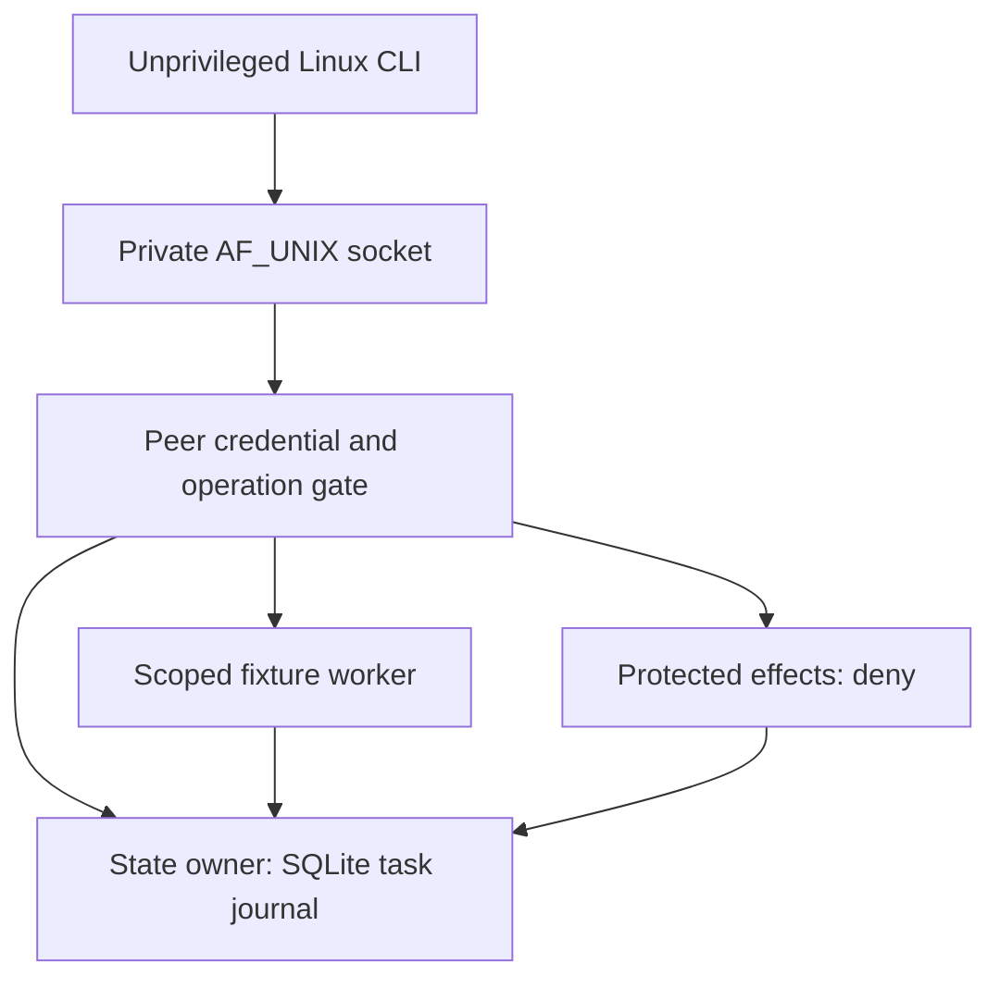

# VeraOS source-to-runtime contract: WSL pilot successor

**Status:** Proposed next engineering gate, **not installed or admitted**.
Accepted `vera-os` `main` at inspection: `31b66b6ff317eb981c4bd8fcc4ae6e5db1d21adf`.
Opt-in development baseline: [Draft PR #71](https://github.com/thebrazenbeard/vera-os/pull/71), head
`6e3925314781b9e288a11ff0e0799e53217e94c3` at the start of this
successor cut, based on that `main`. Subsequent protective commits on the
draft are a separate evidence frontier.
No merge, service deployment, host permission change, autostart, or model load
is authorized by this document.

## Accepted frontier and explicit non-claims

`main` contains historical Buildroot/QEMU resident source and architecture,
but no accepted WSL coordinator service. PR #71 is **four additive files**:
`wsl_pilot.py`, two isolated test modules, and `13-wsl2-local-pilot.md`.
It implements a command-line, same-UID, SQLite-backed fixture with two fixed
actions: size inspection and bounded SHA-256 derivation. It journals submission,
claim, output intent, cancellation and recovery; a cooperative `flock` bars
concurrent recovery during participating worker execution; all protected-effect
requests are denied. PR #71 reported **15/15 actual Lappy Ubuntu-26.04 WSL2 tests**
at its earlier `e2f332e7` head and a local CLI smoke. That is PR-reported host
test evidence, not proof of an integrated or continuously operating VeraOS.

> **Hostile challenge:** The existing "workers" run under one Linux UID and
> have ambient process/filesystem authority. A malicious same-UID peer can
> bypass Python checks, alter SQLite or ignore `flock`. WAL journaling and
> operational receipts are not a protected, independently authenticated state
> authority. Windows mounts and executable interop remain reachable from an
> ordinary WSL process. No one should call this an OS-level worker sandbox.

Unknown/unproved: authenticated socket clients; Patrick-to-OS identity mapping;
separate worker UIDs; protected effect escrow; real memory/consent admission;
real GGUF inference; Windows cold-start availability; backup restoration;
cross-Windows-to-WSL authentication; and performance under model load.

## Next vertical slice: Linux-local session to durable receipt

This is a **target** boundary, not an installed service. This successor adds an
early, bounded AF_UNIX transport (`src/veraos/wsl_ipc.py`, `tests/test_wsl_ipc.py`)
using the existing Pilot directly; it does **not** deliver durable client
session IDs, idempotent requests or independent worker credentials yet.
The future broker owns admission and receipts. Workers should receive
typed work and a narrow fixture handle, not a command line or arbitrary
filesystem path. Identity/orientation, task journal, memories, consent,
permissions, secrets, model artifacts and indexes remain different state
classes. The pilot may only create a fresh **task-journal** class.

### A. Host-owned caller identity, not self-declared chat identity

1. Implement one bounded Linux `AF_UNIX/SOCK_STREAM` listener at an explicitly
   supplied disposable run root under the WSL Linux filesystem. Require a
   private `0700` parent directory, owned socket, no inherited network socket,
   no TCP/HTTP listener and no socket autostart. Refuse to unlink a socket
   still owned by a live process.
2. On `accept`, derive `pid`, effective `uid` and `gid` from the **kernel** via
   Linux `SO_PEERCRED`. Map only an explicitly configured enrolled Linux UID
   to the limited `local_fixture_operator` role. Unknown UID = DENY. The PID
   is audit context, not a reusable credential. Reject client-supplied
   `user`, `actor`, `owner_uid`, `identity_id`, `session_id` and `consent` as
   identity evidence; a forged field cannot override the kernel result.
3. Bound each frame to 8 KiB and a short deadline; reject malformed encoding,
   duplicate JSON keys, unsupported schema/operation, arbitrary paths and
   extra fields. Use a fixed version such as `VERAOS_LOCAL_FIXTURE_V0`, not
   the existing resident HTTP conversation endpoint. The authenticated role
   can submit/inspect/cancel only its own fixture tasks; recovery is a
   separately local-operator-controlled maintenance command.
4. Give requests stable client-generated UUIDs. Persist a unique
   `(principal, request_id)` with a canonical payload digest and receipt;
   byte-identical retries must return the original task/result, while a
   different payload using that ID fails closed. Do not treat a missing
   reply as proof the first operation did not commit.

**Identity ceiling:** `SO_PEERCRED` authenticates a Linux *process UID on that
socket*, not Patrick as a human, a Windows account, an individual same-UID
program, a browser tab, or a model persona. A later Windows attach needs a
separate host-owned, revocable mapping and protected handshake. `Origin`,
localhost, a conversation ID, a model message, and a caller-provided bearer
string are not substitutes. No Windows client is authorized by this phase.

### B. State ownership and effect boundaries

1. Move the persistent SQLite connection behind a single coordinator/state
   owner API. Clients and workers must not receive raw database paths or
   unrestricted SQL handles. Keep one-writer transaction discipline,
   monotonic receipt sequence, durable task ID and explicit ownership fields.
   Validate parent/file modes, actual Linux mount and descriptor identity.
2. Record `REQUEST_ADMITTED`, `TASK_CLAIMED`, `OUTPUT_INTENT`,
   `TASK_COMPLETED`, `CANCELLED`, `RECOVERY_HELD` and `EFFECT_DENIED` in
   transactions with required linkage. Distinguish an operation *requested*,
   *reserved*, *started*, *observed* and *reconciled*. Do not assume a
   filesystem write and its subsequent SQLite commit are atomic.
3. On a controlled process interruption, quarantine uncertain `RUNNING` or
   in-flight effects as `RECOVERY_HELD`; **never automatically retry an
   ambiguous write**. Read back the exact output/inode/hash and journal
   before a human-approved reconciliation transition. A socket retry must
   not create a second task or output.
4. Continue to **deny every protected effect**: Git merge, arbitrary shell,
   network egress, filesystem deletion, messages, credentials, system
   configuration, paid services and financial actions. A future privileged
   effect broker requires independently proven owner authorization, escrow,
   durable idempotency and OS-enforced privilege separation. A Python
   `if approved` branch is not that broker.
5. **No STM bridge or private memory admission.** Existing resident
   `/api/conversation` source handlers are not authenticated memory writers.
   Do not ingest real chats, personal trauma, archives, identity claims,
   credentials or consent records into this fixture. The STM day-30/day-45
   policy does not apply to this task-journal retention, which needs its own
   explicit policy and private backup design.

### C. Two distinct workers and the isolation graduation

Keep the existing positive fixture contracts: `inspect` can inspect at most
8 KiB regular input-file metadata without creating an output; `digest`
may read up to 8 KiB and create **one exclusive** 0600 SHA-256 file under a
dedicated derived directory. The API must never accept arbitrary shell,
model instructions, URLs or caller-selected output paths.

The **WSL source stage** can dispatch these as bounded subprocesses with
fixed inputs, no inherited secrets, timeouts, explicit output caps and
cooperative capability checks, provided it continues to report
`worker_os_isolation=false`. The **OS-authority graduation** requires a
separate candidate Linux VM or native Linux test with actual distinct worker
UIDs, state-service UID and ACL ownership. Show that the read-only worker
cannot write derived/state directories; the digest worker cannot write
state/governance; neither can access Windows mounts, unrelated home data or
secret handles. Measure namespace/mount confinement, process/cgroup limits,
privilege dropping, no-new-privileges and no network where supported. Denial
must come from the kernel/filesystem, not merely a Python exception.

Never change system-wide WSL interop, automount, firewall, service accounts
or user mappings as a shortcut without fresh authorization. If WSL cannot
demonstrate a strong worker boundary without modifying shared Windows
configuration, **stop at source development and graduate the test to a
disposable VM** instead.

## Exact verification gates for the successor PR

The following are **required tests to implement**, not claims that these
files or commands already exist. Keep tests source-only and host tests
separate; the existing `test_wsl_pilot.py` is the baseline.

| Gate | Expected executable observation | Required evidence |
| --- | --- | --- |
| Baseline preservation | `PYTHONPATH=src python3 -m unittest discover -s tests -p 'test_wsl_pilot.py' -v` remains green on exact new head | Count, skips, exit and Python/SQLite versions |
| Socket real boundary | A real Ubuntu subprocess connects through private AF_UNIX; server `SO_PEERCRED` UID matches OS UID; bounded request produces exactly one durable task | Current same-UID thread/socket checks in `tests/test_wsl_ipc.py`; separate-process and cross-UID probes remain outstanding |
| Forged identity | `owner_uid`, `identity_id`, `session_id`, fake `consent`, and mismatched client role all fail closed; no state effects | Negative tests with journal readback, plus independent actual foreign-UID attempt where authorized |
| Framing and duplicate admission | Oversized/malformed JSON and unknown operation denied; same `(principal,request_id,payload)` replay returns original receipt; ID reused with altered payload denied | Real socket clients plus two competing processes |
| Worker contracts | `inspect` cannot emit a digest or write a file; `digest` produces exactly one independently verified SHA-256; symlinks, `..`, changed inode and oversized input rejected | `tests/test_wsl_worker_ipc.py` with actual files/subprocesses |
| Crash/recovery | Owned worker killed only at deterministic post-intent checkpoint; restart marks work held, performs no replay, readback exposes ambiguity | `tests/test_wsl_socket_recovery.py`, SQLite readback and effect-path hash |
| No ambient effects | No subprocess receives host credentials; no TCP listener; merge/delete/network proposals all denied with durable receipts | fd/env inventory (redacted), OS socket listing and negative requests |
| OS separation graduation | Three separate OS principals; direct writes to state/other worker scope receive `EACCES`/`EPERM` even with bypass code | Disposable VM/native `tests/test_worker_os_isolation.py`, explicit real UID/ACL/mount evidence; **HOLD** on same-UID WSL |
| Windows attach and lifecycle | Windows-to-WSL identity binding and WSL suspend/logoff/restart persistence tested against an independently authorized disposable host environment | Dedicated future integration run; **not part of next source PR PASS** |

All tests must use only synthetic generated fixtures and test-owned state on
the Linux filesystem. A mocked UID test establishes parser logic, **not**
foreign-UID enforcement. Do not trigger Windows reboot, `wsl --shutdown`,
Docker restart, persistent service installation, package installation or
GPU/model loading on Lappy to claim a gate. Save the exact tested Git SHA,
test commands and failures, socket path ownership, task IDs, receipt order,
output hashes, Linux kernel/WSL build, host RAM/load and interruption point.
If a gate is unsupported, report `HOLD/NOT TESTED`, not PASS.

## Host choice: evidence before promotion

| Candidate | Qualified next role | Blocking test before authority |
| --- | --- | --- |
| Lappy Windows + WSL2 | Disposable local CLI/socket development, Linux API and SQLite recovery | Prove Linux-only socket trust, mount safety and user workload headroom; Windows controls WSL lifetime |
| Dedicated Linux VM on VN1/VN2 or approved host | Test OS-separated workers and restart/rollback under isolated ownership | Measure resource use, UID/ACL isolation, allowed mounts, uptime and backup readback on an approved idle host |
| Native Linux node | Candidate longer-lived governed coordinator/state service | Qualify availability, protected boot/restart, durable backup restore, OS authorization and rollback |

`systemd` working inside WSL does not imply Windows logon/boot persistence.
NixOS is still an OS configuration candidate, not the accepted authority
root. The Windows ecosystem root stays **`D:\VERA`**, while this experimental
Linux state stays in a fresh private **WSL ext4** path; never use obsolete
`C:\VERA` or turn `/mnt/d/VERA` into an unbounded worker mount.

### Stop/decision rule

Stop for unclear owner/UID mapping, symlink/mount ambiguity, unexpected
host contention, resource headroom loss, another live socket owner, proof of
unauthorized file access, untrusted request admission, unexpected egress,
ambiguous effect replay or any request for money, credentials, private memory,
autostart, host restart, user/account changes or Windows security changes.
The operating budget is **$0**. The successor remains a draft until these
source/WSL tests are independently rerun at exact head. Even a green draft
is **not** authority for merge or deployment; Patrick reserves that decision.
