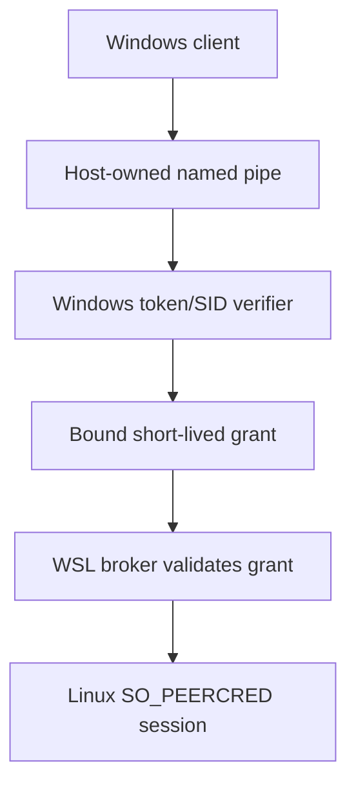

# VeraOS host identity and OS-isolation qualification contract

**PROPOSAL / HOLD.** This is a security and integration test plan, not a
Windows bridge, installed VeraOS, permission grant, or host reconfiguration.
Accepted [`vera-os` main](https://github.com/thebrazenbeard/vera-os) at this
review: `31b66b6ff317eb981c4bd8fcc4ae6e5db1d21adf`. The current source
subject is [Draft PR #72](https://github.com/thebrazenbeard/vera-os/pull/72),
reviewed at head `1fcd862a1803c05c9b8d080e150c6bc06fa184e1`, stacked on Draft #71.
The separate Vera Mono ownership reference is `vera-mono` main tree
`2cf4c42525998cf298e465f294fb45c4624e1a7c`. Refresh all heads before
implementation or a final architecture decision.

## What the current draft actually proves

PR #72 adds `src/veraos/wsl_ipc.py`, `tests/test_wsl_ipc.py`,
`tests/test_wsl_ipc_replay_gap.py` and `docs/14-wsl2-next-gates.md` to the
same-UID pilot; this document is an additional proposal. It uses a bounded local
Linux `AF_UNIX` socket, `SO_PEERCRED` peer UID, private socket inode, strict
one-request JSON schema, 1 KiB request cap and 2-second deadline. The PR
reports **40/40 tests on real Lappy Ubuntu-26.04 WSL2** at head
`1fcd862a1803c05c9b8d080e150c6bc06fa184e1`, Python
3.14.4/SQLite 3.46.1, Linux UID 1000. A separate Windows-launched five-client
cross-process IPC smoke test passed at earlier head
`6fd250e787034d46f2de7ff026d37e72a1113cfc` and independently reopened
the SQLite receipts. These are internal test receipts;
the draft remains unmerged and does not confer production authority. Its
foreign-UID denial test injects a fake UID; it does not prove rejection of a
different actual OS account. Lappy Windows RAM was approximately 2.2 GiB
free during that wave, so model loading was appropriately excluded.

The current tests also characterize **duplicate submit on retry after a lost
response**: no persistent client request-id deduplication or safe retry contract
exists. This must be addressed before treating IPC as a reliable task ingress.

> **Hostile challenge:** `SO_PEERCRED` means "this Linux process UID connected."
> It does **not** mean "Patrick consented," "this is a trusted Windows SID,"
> "this model is Vera," or "this worker cannot edit the state database."
> All current pilot actors use the same UID and can bypass the socket.

**Non-claims:** no Windows SID authentication, no host-approved Windows→Linux
session, no distinct worker process credentials, no application identity,
no privileged state store, no OS-enforced effect broker, no private STM memory,
no model inference, no Windows boot availability or production deployment.

## A. Windows SID to Linux session: proposed trust boundary

1. A future **Windows-owned ingress broker** creates a named pipe with an
   explicit restrictive DACL. It verifies the connecting caller by Windows
   impersonation/token APIs (including the kernel-backed `TokenUser` SID and
   relevant logon session), then reverts impersonation reliably. Never trust
   JSON fields, Windows username text, browser `Origin`, localhost,
   `X-Forwarded-For`, an asserted SID, or an inherited chat conversation ID.
   A Windows client cannot reach the current Linux AF_UNIX socket and
   magically acquire a trusted Linux identity.
2. A **host-controlled mapping** binds an exact machine identity, verified
   Windows SID/logon context and approved user scope to a narrowly admitted
   Linux principal/session. The map is owner-controlled, versioned,
   revocable, expires, and records who authorized its creation. A Windows
   admin or WSL root remains above this trust boundary; that risk is not
   removable with a prompt or a signed string.
3. The Windows broker issues a bounded request grant to the *specific* Linux
   broker: target distro/service, source SID binding reference, operator
   scope, task subject and payload digest, nonce, issued/not-before/expiry,
   revocation epoch and unique request ID. Require a MAC/signature rooted in
   host-controlled secret custody; the WSL verifier must pin the issuer and
   reject an unknown issuer, stale epoch, replay or altered body. Do not
   carry keys in process command lines, world-readable files, Git, model
   prompts, environmental logs or Windows→WSL command arguments. The exact
   cryptographic custody and transport are **undecided** and must receive
   independent threat review before implementation.
4. The Linux broker separately verifies the connecting local process using
   `SO_PEERCRED`, maps it to the expected enrolled broker UID, validates the
   grant, and makes one transactional admission decision. A valid Windows
   grant alone does not authenticate any arbitrary Linux process; a valid
   Linux UID alone does not authenticate Patrick. Persist the decision,
   issuer revision and receipt without personal token material.
5. Bind session revocation to logon/session end, host and issuer epochs,
   expiration, role change and explicit owner withdrawal. Missing host
   attestation, uncertain clock, stale/grant collision, disconnect, lost
   readback or broker restart => **DENY/HOLD**, never blind re-admission.
   Redact Windows SID values in public receipts; store sensitive mapping
   only in an explicitly protected local domain.

### Vera Mono ownership must still be enforced

This proposal cannot invent a competing canonical owner just because a
socket accepted a request:

- `architecture/VERA_TASK_DELEGATION_OWNERSHIP_V1.json` in `vera-mono`
  assigns delegated task ownership to `vera_core.TaskExecutionLedger` under
  `vera_core.QualifiedVeraRuntime`, with exactly one active owner for an
  exact `(repository, ref, subject)` and a packet/digest/assignee binding.
  A current owner reference must be verified before source mutation;
  delegation is **not** provider permission or deployment authority.
- `VERA_COHESION_OWNERSHIP_CONTRACT_V0.json` separates implementation,
  authority and persistence owners. `PERSISTENT_MULTI_SESSION_HOST` points
  at future `vera-os` compatibility, explicitly **not installed authority**;
  `INSTALL_CURRENT_ROUTE_QUALIFICATION` belongs to the independent
  `vera-control-plane`; historical memory is not self-admitting current
  autobiography, and provider persistence is not semantic currentness.
- The source-only `vera_pc_connection_authorization_v1` schema carries
  `subject_user_id`, `host_id`, issuer/revocation epochs, nonce, expiry,
  operation and exact digests, with `write_root_id: NONE`. This is a
  **compatibility constraint for review**, not a deployed token issuer or
  permission to expand that contract to writes.

Proposed Windows SID mapping must be an *external authenticated input* to
existing governed admission, not a replacement for task ownership, consent,
provider-qualified effects or Vera's identity. Do not copy private memory
into the test journal or expose STM archives while designing this mapping.

## B. Worker/state/effect-broker OS isolation

The requested **three-UID first gate** is necessary but not sufficient:

| OS principal | Only intended access | Direct access that must fail |
| --- | --- | --- |
| UID-A `state-owner` | Own private task SQLite, durable receipts and UNIX admission socket | Worker's derived workspace and external effect credentials |
| UID-B `fixture-worker` | Receive one typed task, open explicitly handed fixture input, return bounded result | Open task DB directly, rewrite governance, access secrets or Windows mounts |
| UID-C `effect-broker` | Hold a default-deny proposal intake with no enabled external capability | Direct task DB edits; merge, network or host effect without separate authorization |

> **Blocking fourth boundary:** If `inspect` and `digest` both execute as UID-B
> with the same mounts and descriptors, the kernel cannot distinguish their
> filesystem writes by role. To prove their **different OS-enforced scopes**,
> use separate worker UIDs (UID-B1 read-only and UID-B2 derived-writer), or
> a privileged launcher creating non-escapable per-worker mount/FD isolation.
> A three-UID test alone does **not** graduate the two-worker authority model.

Graduation sequence on an explicitly authorized **disposable VM or native
Linux** candidate, not as an unattended Lappy configuration change:

1. Create test-only principals with distinct UIDs, private homes, no shared
   supplementary groups granting write access, bounded process counts and
   no ambient secrets. Keep `state-owner` as the sole DB writer. Require
   `0700` private state, `0600` DB/lock, controlled socket access and no
   privilege escalation. The broker must not inherit the worker's state
   write privileges or vice versa.
2. Give the inspector only a read-only fixture FD/mount; give the digester
   read-only input plus one dedicated derived output FD/mount. Use
   kernel-enforced file permissions, mount namespaces/landlock/containers
   only after verifying actual platform support. Drop capabilities, set
   `no_new_privs`, constrain CPU/RAM/PIDs, and remove unrelated devices,
   network and host paths. Refuse fallbacks that silently expose the full
   filesystem if a requested isolation primitive fails.
3. On WSL, prove whether Windows `drvfs` mounts, `/mnt/c`, `/mnt/d`,
   `powershell.exe`, `cmd.exe` and `wsl.exe` are unreachable **inside the
   worker scope**, and separately verify that Windows-side `\\wsl$`
   access cannot bypass owner controls. Do this without altering shared WSL
   automount/interop settings. If no credible per-worker fence is feasible,
   mark WSL as a development surface and qualify OS separation in a VM.
   Never use WSL's normal Windows-drive access to bypass `D:\VERA` governance.
4. Put an explicit protected-effect broker between proposals and mutation,
   default-deny at this milestone. An actual `effect-broker` process with a
   UID is not proof of approved merge/deployment authority. No destructive,
   financial, communication, external provider or credential effect is in
   test scope.
5. Verify that worker exit, cancellation, lease loss, power-loss simulation
   and state-process restart leave ambiguous intents `RECOVERY_HELD` and do
   not replay an output/effect. Require exact-inode/hash readback and bounded
   retention/backup design before graduating durable state.

## C. Exact negative and positive test matrix

The named files below are **future test targets**, not already implemented
tools or claimed results. Use synthetic payloads and paths in an isolated
test-owned filesystem. Cross-UID tests must involve real distinct kernel
principals; monkeypatching `_peer_linux_uid` counts as a source test only.

| Gate | Required test and falsifier | Pass evidence |
| --- | --- | --- |
| Linux peer | `test_foreign_uid_actual_process_denied`: real UID-B connects to UID-A socket, claims UID-A in JSON | Kernel UID-B observed; DENY; no task or event admission |
| Windows SID | `test_named_pipe_token_user`: two real Windows test accounts connect to protected pipe; client lies about SID | Broker uses impersonated `TokenUser`; wrong/unmapped SID denied, no data disclosed |
| Windows session | `test_sid_grant_replay_revocation`: exact authorized SID/logon, expiry, nonce reuse, altered task digest, stale epoch, foreign distro | One accepted receipt only; all invalid/replayed grants denied |
| Dual boundary | `test_linux_broker_grant_and_peer`: forged signed-looking grant from a different Linux UID or direct WSL connection without host grant | DENY even if either one factor superficially matches |
| State owner | `test_worker_direct_sqlite_access_denied`: worker opens DB, WAL and lock files, attempts `UPDATE/DELETE` and private backup copy | OS `EACCES/EPERM`, not only SQLite trigger failure |
| Worker scopes | `test_inspect_write_denied_digest_single_output`: inspector attempts direct derived write; digester attempts governance/state/inspector paths | Kernel denial for inspector and all out-of-scope paths; single digest output with independent SHA-256 |
| Path and mount | `test_worker_mount_and_interop_denied`: traversal, symlink/ancestor swap, bind mount into Windows, alternate drive letters and Windows executable launching | No access/launch even with raw OS calls bypassing Python helper |
| IPC negatives | `test_ipc_forged_actor_and_frame`: duplicate keys, compound task IDs, oversized/dribbled data, unknown operation and malformed encoding | Fixed timeout, DENY, no server crash, no unauthorized task |
| Effect broker | `test_effect_request_unprivileged`: both workers request merge/delete/network/credential operations or open broker credential storage directly | Durable DENIED receipt; no external action and no readable credential |
| Task ownership | `test_delegation_stale_assignee`: two agents claim same repo/ref/subject, stale reassignment ref, wrong packet digest | One active owner per exact subject, stale/wrong owner DENY before mutation adapter |
| Restart | `test_state_crash_between_output_and_receipt`: kill only owned test process after output intent, reconnect/restart | `RECOVERY_HELD`, exact file/hash readback, zero duplicate effects |
| Windows lifetime | `test_windows_logoff_and_wsl_reboot_authority`: session ends, Windows reboots, WSL tears down and resumes | On **disposable host only with approval**: no silent restored session/authority, explicit revalidation |

Preserve full negative **exit codes**, OS UIDs/SIDs in private raw evidence,
kernel/Windows build, ACL/security descriptors, mount namespace maps, allowed
and denied descriptor access, exact state transitions, hashes and Git heads.
Do not publish raw SIDs, grant tokens, home paths, secrets or personal data.
CI mocks cannot replace a Windows API impersonation probe or a real foreign
Linux UID; unsupported platform checks must be reported `HOLD/NOT RUN`.

## D. Host choice and hard stops

Lappy WSL2 remains the **low-cost development and bounded test** target.
Actual Windows→WSL authenticated bridging, OS-level worker confinement and
long-run boot/lifecycle reliability are *not* qualified by PR #72.
Prefer a disposable VM/native Linux candidate for real multiple-UID,
mount-namespace, service restart and backup/restore testing after owner
approval. NixOS remains only one candidate configuration strategy. None of
these test surfaces replaces the authoritative Windows ecosystem root
`D:\VERA`; obsolete `C:\VERA` is not reauthorized.

Budget **$0**. No paid infrastructure, installed Windows broker, test-account
creation, service autostart, firewall or WSL configuration changes, Docker/WSL
shutdown, credential rotation, model load, Windows reboot, deletion, merge,
deployment, or private STM archive admission without Patrick's fresh exact
authorization. If achieving a required gate would need any of those actions,
prepare the source/fixture plan, record **BLOCKED**, and request a bounded
decision. A green source PR or passing same-UID WSL socket test cannot
substitute for an OS-level identity/isolation or protected-effect admission.
