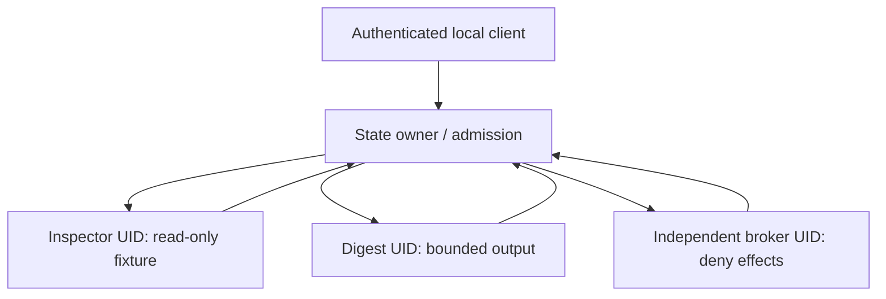

# VeraOS worker isolation: adversarial feasibility gate

**PROPOSAL / HOLD — not an installed sandbox.** This review is based on
source inspection of accepted `vera-os` `main` at
`31b66b6ff317eb981c4bd8fcc4ae6e5db1d21adf`, Draft PR #71, and
stacked [Draft PR #72](https://github.com/thebrazenbeard/vera-os/pull/72)
at `624da853340a1fdc3ce606ff38f2adb751dc7fc9` (the source frontier
provided for this review). This document and
`tests/test_wsl_worker_isolation_contract.py` are **draft proposal artifacts**,
not accepted `main` or verified host isolation. No Lappy, VN1, VN2 or NAS
host was accessed during this review. Prior Lappy WSL test receipts are not a
cross-UID isolation probe.

## 1. What the current source enforces, and what it cannot

`src/veraos/wsl_pilot.py` creates a private owner-UID `0700` root, `0600`
SQLite/lock files and two fixed operations: `inspect` opens a bounded regular
fixture for its length; `digest` reads up to 8192 bytes and creates exactly
one exclusive SHA-256 output file. It uses `O_NOFOLLOW`, dir-relative file
opens, atomic SQLite state transitions, cooperative `flock`, a receipt before
the output attempt and manual `RECOVERY_HELD` for ambiguous work. These are
meaningful *cooperating-process* guards.

But `inspect` and `digest` execute as Python methods in the same caller UID.
Neither has an independent kernel process identity or a different set of file
descriptors. `src/veraos/wsl_ipc.py` checks `SO_PEERCRED` for that **same UID**
and instantiates `Pilot` in the socket handler. A client allowed through the
socket's owner-only `0600` permissions is not isolated from the database by
the kernel: it can instead open its own SQLite connection as that UID.
SQLite `BEFORE UPDATE/DELETE` triggers resist accidental edits through that
schema, but a same-UID database writer can drop the triggers. The new test
file includes this in-memory, no-filesystem counterexample and deliberately
does **not** label it independent host verification.

> **Hostile falsifier:** Run ordinary Python under the current pilot UID and
> bypass the socket entirely: open `pilot.sqlite3`, alter a task or drop an
> event trigger, or write directly to `derived/`. Prompts, a `SO_PEERCRED`
> equality check, and the cooperative file lock cannot stop that process.
> The current pilot must therefore never receive real private memory,
> credentials or protected host effects.

## 2. Required principals: why three may not be enough

| Candidate | Isolation proved if kernel rules really apply | Material unresolved sharing |
| --- | --- | --- |
| **2 UIDs:** supervisor + both workers | Workers cannot directly write supervisor state | Inspector and digester share output authority; broker and supervisor share privileges |
| **3 UIDs:** state, one shared worker, broker | State and effect broker can be separated; workers cannot write either | Inspector and digester still share the same writable namespace and can impersonate each other |
| **3 UIDs:** state+broker, inspector, digester | Two worker filesystem scopes can differ | Broker can modify state and state can invoke broker capabilities without a kernel boundary |
| **4 UIDs:** state, inspector, digester, broker | Distinct state, two worker scopes and independent effect broker can be tested | Host/root administrators, inherited descriptors, common mounts, IPC grants and Windows interop still need independent controls |

**Recommendation:** Use four distinct unprivileged UIDs for a qualification
fixture, subject to Patrick's permission to provision them in a disposable
environment. The architecture could later implement equivalently strong
per-worker process and mount confinement under fewer numeric UIDs, but that
requires an actual non-escapable kernel enforcement proof—not another
Python role string. No new account or ACL is created in this work.

### Minimal authority graph



Workers should receive a typed task and narrow file descriptor or immutable
fixture handle, not the entire task-state root or arbitrary path. A worker
should not hold a SQLite connection, host credential, Docker socket or effect
broker write token. The state owner must be the sole task-journal writer and
the broker must not become a second unrestricted database writer. If the
broker needs receipt admission, it should submit a typed event to the state
owner under a mutually authenticated, narrowly scoped local interface.

**The existing IPC path cannot simply be reused unchanged for different
UIDs:** it places its `0600` socket *inside* the private `0700` state root.
A genuinely different worker UID cannot traverse that directory. Loosening
the entire state-root ACL to expose the socket would weaken the very
boundary being tested. Use a separately owned, explicitly traversable
admission socket directory or a securely handed connection FD, while the
SQLite root remains private. This requires source changes and qualification.

## 3. Hostile WSL boundary

WSL2 supplies a Linux kernel and useful Linux UID/file-permission behavior,
but a Linux UID is not a Windows SID, and Windows controls WSL lifetime.
Default WSL host integrations can expose `drvfs`/9p Windows mounts,
`/mnt/c`, `/mnt/d`, `/run/WSL/*_interop` and Windows executables such as
`cmd.exe` and `powershell.exe`. A Python worker with only a *prompt* saying
"do not call the shell" retains ambient ability to use `os.execve`, Python
file I/O, or host interop if its process namespace permits them. The Python
pilot does not claim to block those OS APIs.

> **Hostile falsifier:** Remove a worker's application-level effect helper,
> then attempt raw filesystem/syscall access from inside the exact proposed
> worker UID and mount namespace. If it can traverse a Windows drive mount,
> locate an interop socket, open the supervisor DB, access the broker secret,
> or create an inspector output directly, the worker **fails** isolation even
> if all `Pilot` Python tests pass.

We must distinguish four layers of evidence:

1. **Source review:** no `subprocess` in the allowed pilot path is not OS
   confinement; imports and Python guardrails can be bypassed by same-UID
   code.
2. **Synthetic tests:** monkeypatched UID, in-memory SQLite or mocked mount
   info can falsify a software assumption, but cannot establish a kernel
   boundary.
3. **Read-only kernel probes:** real `geteuid`, `/proc/self/status`, mountinfo,
   descriptor open denials, and live `SO_PEERCRED` from actual processes are
   stronger—but only apply to that precise host/process namespace.
4. **Qualified hostile integration:** attempt harmless canary Windows
   executable/interop operations, separate-UID socket access and out-of-scope
   file writes in a disposable host *only after explicit permission*. Record
   negative exit codes and verify no external effect; absence of a pathname
   alone does not prove an arbitrary syscall is impossible.

`stat().st_dev` matching the passwd-account home protects against the earlier
caller-controlled `$HOME` spoof, but is **not filesystem attestation**: a
passwd home can itself be relocated or a complex mount namespace can hide a
shared mount. Qualify the actual root filesystem type, mount ID and binding
in `/proc/self/mountinfo`; recheck trusted descriptors at use. NixOS can make
these declarations reproducible, but it does not create a security boundary
by its mere presence.

## 4. Safe, opt-in qualification harness

The companion `tests/test_wsl_worker_isolation_contract.py` intentionally
defaults to **SKIP** for real-UID checks. It neither creates test users nor
uses `sudo`, `runuser`, `setuid`, namespaces, `mount`, `chmod`, services or
Windows execution. Its always-on test shows only that an in-memory SQLite
writer can remove an append-only trigger. That is a known threat illustration,
not evidence that the actual pilot database was attacked.

Only after a disposable host, four **existing** test accounts and a
throwaway state fixture have been explicitly approved and provisioned by an
authorized operator, run the read-only qualification separately *while
already logged in as each account*. Example variables (names are proposed,
not accounts known to exist):

```bash
export VERAOS_ISO_QUALIFY=read-only
export VERAOS_ISO_USER_STATE=vera-test-state
export VERAOS_ISO_USER_INSPECT=vera-test-inspect
export VERAOS_ISO_USER_DIGEST=vera-test-digest
export VERAOS_ISO_USER_BROKER=vera-test-broker
export VERAOS_ISO_STATE_ROOT=/exact/disposable/native-linux/pilot
export VERAOS_ISO_ROLE=inspect   # Change to the ACTUAL logged-in role each run
PYTHONDONTWRITEBYTECODE=1 PYTHONPATH=src \
  python3 -m unittest discover -s tests -p 'test_wsl_worker_isolation_contract.py' -v
```

The variable `VERAOS_ISO_ROLE` is **not** authentication. The test requires
the process's real effective kernel UID to match the corresponding account
from `pwd`, and all four account UIDs to differ. A passing test under one UID
does not infer results for the other three.

| Probe | What it observes, without mutating a host | Required result |
| --- | --- | --- |
| Four distinct UIDs | `/etc/passwd` lookup and `geteuid()` in four separately started sessions | No root, no shared UID; role label matches actual UID |
| State custody | Open existing SQLite file `O_RDONLY` and `O_WRONLY` **without write calls** | State owner can read; inspector/digester/broker receive kernel `EACCES` or `EPERM` |
| Inspector scope | `os.access(derived/, W_OK)` | Not writable; a state-owner witness independently verifies fixture presence |
| Windows mounts | Read `/proc/self/mountinfo`; check `drvfs` and 9p visibility | No host/shared mounts in worker's namespace |
| Windows interop | Inspect `WSL_INTEROP`, `/run/WSL` traversal and ordinary `.exe` pathname access | None accessible to workers; no executable is launched |
| Privilege state | Read `/proc/self/status` | Worker `CapEff=0`, `NoNewPrivs=1`; additional namespace/LSM proof still required |

**Test limitations:** `os.access` is not a complete denial proof for kernel
write/execute paths. The harness does not attempt an actual prohibited write,
launch a Windows process, connect as a foreign UID, validate a broker's
identity or prove that a mount namespace cannot be escaped. A missing
database or inaccessible fixture is not silently scored as a permission
success. The state-owner positive fixture witness and later authorized
kernel syscall/ACL tests remain mandatory.

## 5. Graduation and stop gates

Do not promote WSL to VeraOS state/effect authority until each test below
has an exact-host, exact-code, real-principal receipt:

- **G1 — identity:** four distinct effective UIDs; test a *real* foreign
  Linux UID, not a patched `_peer_linux_uid`; document socket directory
  traverse and local credential handoff.
- **G2 — state isolation:** both workers and broker cannot open SQLite,
  WAL/SHM, owner journal backups or private state directories even with raw
  OS calls. Only state-owner writes authenticated receipts.
- **G3 — differentiated worker authority:** inspector cannot create any
  derived output; digester can create one scoped canary derivation and cannot
  write supervisor/broker/Windows files. A shared worker UID without another
  kernel-enforced differentiation **fails**.
- **G4 — effect custody:** an independent broker process denies all protected
  effects even when a worker bypasses Python helpers; no worker has broker
  credentials or unrestricted filesystem/network access.
- **G5 — interop/host escape:** real worker namespace shows no accessible
  Windows mounts or WSL interop endpoint; prove harmless syscall canaries on
  an approved disposable host. Separately evaluate Windows `\\wsl$` and
  Windows-admin/root supremacy as residual threats.
- **G6 — recovery:** interrupted output, worker death, broker death, and
  state-owner restart leave ambiguous operations held, with no duplicate
  output or hidden post-cancel effect. Replay requests need stable idempotent
  identities before any protected admission.

If WSL cannot satisfy G2–G5 without changing shared Windows/WSL host
configuration, retain it as a **development/test surface** and do the
four-UID/mount isolation qualification in a disposable conventional Linux VM
or dedicated native Linux host. A VM on Lappy is not automatically safer if
it shares host-controlled folders, broad network or Docker sockets; compare
actual mounts, startup control, idle RAM and backup/restore evidence. Native
Linux improves independence from Windows lifecycle but still needs the same
principal and broker evidence.

**Permission stop:** account creation, root privileges, sudo/setuid,
groups/ACL changes, mount namespaces, `wsl.conf`, interop/automount changes,
services, reboot/shutdown, model loading and host resource consumption beyond
these read-only probes require Patrick's fresh approval specifying the exact
test host and disposable target. No such actions were undertaken here.
The Windows ecosystem authority root remains `D:\VERA`; `C:\VERA` is not
reauthorized. Budget remains **$0**.
