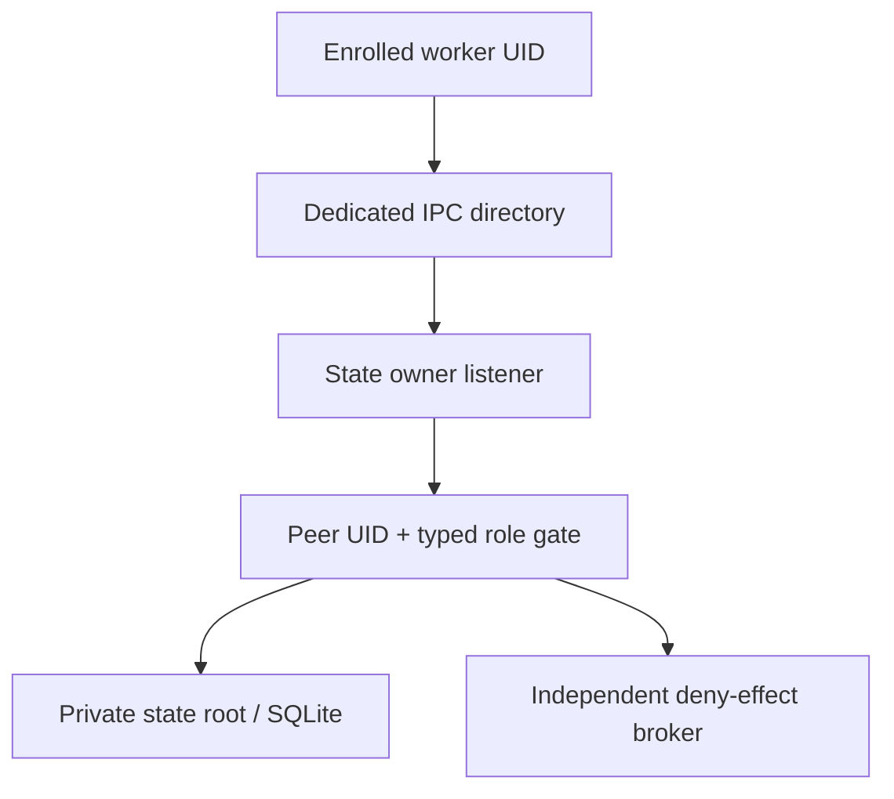

# Worker peer boundary: separate the socket, not the state root

**SOURCE REVIEW / PROPOSAL / HOLD.** Reviewed `thebrazenbeard/vera-os`
Draft [PR #73](https://github.com/thebrazenbeard/vera-os/pull/73) at
`54b37ee498b48756a9666f28a17cdea7a919938a`, stacked on #72. The
accepted `main` remains `31b66b6ff317eb981c4bd8fcc4ae6e5db1d21adf`.
The companion `tests/test_worker_peer_boundary_source.py` is a pure source
and UNIX-permission-model characterization, **not** a kernel cross-UID test.
No accounts, ACLs, mounts, sockets, Windows settings or services were changed
as part of this review.

## The immediate incompatibility

Three independent facts from the draft source interact:

| Exact source | Enforced behavior | Consequence |
| --- | --- | --- |
| `src/veraos/wsl_pilot.py` `Pilot.init` | State root created `0700`, SQLite/lock `0600`, owner UID checked | Foreign workers cannot traverse the state root |
| `src/veraos/wsl_ipc.py` `serve` | AF_UNIX socket bound at `Path(root).absolute() / "pilot.sock"`, then chmod `0600` | The socket is inside the inaccessible directory and itself owner-only |
| `serve` request loop | Accepts only `_peer_linux_uid(client) == _uid()` | Even if filesystem permissions changed, a distinct worker UID is rejected |

> **Hostile challenge:** Granting a future worker membership in a socket
> group, then changing only `pilot.sock` from `0600` to `0660`, does not let it
> traverse the enclosing `0700` state directory. Broadening the *state root*
> to `0750` just to make the socket reachable would expose a new filesystem
> discovery surface and blur state ownership. A group permission grant is
> also not authorization to execute a particular worker operation.

The test source checks the current AST and a minimal DAC search/write-bit
simulation. This is a counterexample to an assumed architecture, not evidence
that a second Linux account actually connected or was denied on Lappy.

## Smallest credible source split

Do **not** migrate the SQLite file or relax its root. Split state and
admission paths in a future opt-in, disposable implementation:

Proposed fixture layout, not a directory known to exist:

| Object | Example mode/ownership | Constraint |
| --- | --- | --- |
| Private state directory | `0700`, state-owner UID | No worker or broker traversal |
| SQLite, WAL/SHM, lock and state backups | `0600` or tighter, state-owner UID | Only state-owner opens for SQL; protected receipts cannot be edited by worker |
| Separate IPC directory | `0750`, state-owner UID + dedicated enrolled-client group | Not nested under private state root; no world-write; parent components audited |
| AF_UNIX socket in IPC directory | `0660`, state-owner UID + that group | Group permits *connect*, not task authorization; exact bound inode cleaned up safely |
| Worker data/derived path | Separate per-worker mounts/FDs | Inspector read-only; digester limited output handle; neither sees state DB |

An alternate design is a supervised, securely handed connection FD, but be
careful: a socket connected **before** dropping identity can retain peer
credentials from the connecting process. Record the real `SO_PEERCRED` UID
after worker identity change, and reject any credential inconsistency.
Whichever path is chosen, the server must run with the state owner's UID,
not execute arbitrary worker Python code inside that state process.

### Admission must be two independent checks

1. Kernel filesystem checks determine whether a process can reach/connect
   to the socket. Use a narrowly provisioned client group or explicit ACL;
   no `0777` directory and no `0666` socket fallback.
2. The server obtains **kernel** `SO_PEERCRED` and maps that actual UID to an
   enrolled `inspect`/`digest`/broker operation scope under state-owned
   configuration. Deny unknown UIDs, wrong operations, self-declared
   `user`, `uid`, `role`, `actor`, or any absent/expired grant.

Socket group membership is not proof of Patrick's Windows identity or of
consent. The current `_submit_keyed` uses the **server** `_uid()` as the
idempotency principal, which is equivalent to peer UID *only while admission
strictly requires the same UID*. A later multi-UID implementation must derive
the durable principal from an authenticated peer/session mapping; otherwise
multiple clients collide under the state-owner UID's replay namespace.
Bind request-id/payload hashes to that principal and policy epoch before
admitting effects. No private STM or credentials belong in these fixtures.

## Required falsifiable negative tests (permission gate)

These are **future integration tests**, not completed results. They require
pre-existing real test UIDs and explicitly approved disposable permissions.

1. **Owner positive:** State process sees a real `0700` state root and can
   open the exact SQLite DB. Capture inode, owner, mode, mount type and
   process UID in private receipts.
2. **Foreign worker state denial:** Real inspector/digester/broker UIDs try
   `open` on SQLite, WAL, lock and backup paths. `EACCES/EPERM` is required;
   missing fixtures do not count as permission denial. Raw SQL and direct
   `derived/` writes must also be denied outside the narrow worker grant.
3. **Socket availability:** Those same real UIDs can traverse only the new
   IPC directory and connect to the socket after explicit enrollment. An
   unaffiliated UID cannot traverse/connect. Both checks must be captured
   independently of server JSON responses.
4. **Peer role denial:** With a connection permitted by a group, send forged
   JSON UID/role and operations outside the enrolled role. `SO_PEERCRED`
   remains authoritative and the state-owner logs an unambiguous DENIED
   event; no submission, filesystem write or provider action occurs.
5. **Worker type split:** Inspector tries a direct derived-file creation
   (must fail), digester receives only a bounded per-task output handle,
   both try to reach state and broker credential paths (must fail). Distinct
   UIDs are necessary unless an equally strong kernel process/mount barrier
   is separately proven.
6. **WSL escape:** Inspect mountinfo and syscall-level access from *inside*
   each worker scope. Alternate Windows `drvfs`/9p mount points, `/mnt/c`,
   `/mnt/d`, `/run/WSL/*_interop`, `cmd.exe`, `powershell.exe` and Windows-side
   `\\wsl$` host access need explicit negative evidence. Merely not calling
   `subprocess` in application code does not qualify this boundary.
7. **Failure/custody:** Kill only the owned disposable worker at controlled
   output/receipt seams; state stays consistent or `RECOVERY_HELD`; retry is
   idempotent and cannot double-create output. An unaffiliated peer exhausts
   no unbounded listener resources.

The source-only regression tests added with this document validate **none**
of those live kernel denials. They deliberately lock in the current
incompatibility so a future path change forces a fresh review and exact UID
tests. Do not label model agreement or an AST assertion `REAL_SYSTEM_PROBE`.

## Feasibility decision

**WSL2 is suitable to prototype the split and run controlled IPC/SQLite
smokes**, as PR #71–73 have already explored. It does not automatically
become an always-on authority root. A WSL worker might still inherit direct
Windows-drive access, host executable interop, accessible `/run/WSL`
endpoints or elevated container/Docker mounts. Changing shared `wsl.conf`,
automount, privileged launchers or host ACLs is a meaningful owner effect,
not a safe default development tweak.

If a narrowly scoped worker namespace cannot suppress these routes without
host-wide changes, retain WSL as a development surface and qualify the same
four-UID contract in a disposable conventional Linux VM or native Linux
host. NixOS can encode reproducible mounts/users but is not isolation by
configuration label alone. A Linux VM with shared Windows folders still
fails the same hostile test.

**STOP / seek Patrick's authorization** before creating Linux users,
changing groups or ACLs, binding a new service socket outside a disposable
test tree, enabling mount/user namespaces, installing packages, changing
Windows/WSL interop, restarting a service/machine or allowing any protected
effect. Keep budget `$0`, preserve authoritative `D:\VERA`, and leave
`C:\VERA` obsolete. This document authorizes no such operations.
