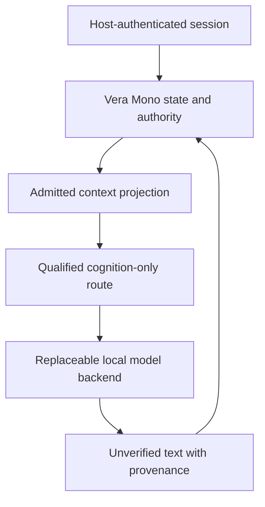

# VeraOS inference adapter boundary — source integration proposal

**Status: SOURCE/DOC PROPOSAL, HOLD.** No model backend, local GGUF, identity issuer, private memory bridge or VeraOS deployment is qualified by this document. It authorizes no network listener, download, GPU load, tool invocation, host modification, merge or spend. The authorized Windows root is `D:\VERA`; `C:\VERA` is obsolete.

## Current exact sources and distinct contracts

Inspected 2026-11-05 UTC. **Accepted main** and **draft head** are deliberately separate:

| Owner/source | Exact Git commit and inspected implementation | Capability and present claim ceiling |
| --- | --- | --- |
| [`vera-os` accepted main](https://github.com/thebrazenbeard/vera-os/tree/31b66b6ff317eb981c4bd8fcc4ae6e5db1d21adf) | `31b66b6ff317eb981c4bd8fcc4ae6e5db1d21adf`, `src/veraos/cognition_provider.py`, `model_admission.py`, `native_cognition.py`, `virtio_model.py` | Descriptor *shape* checks and optional local OpenAI-compatible `Pre-Active` route; no trusted signed-issuer verification. Historical VirtIO model name is `qwen3:4b-instruct`, **not** the official `Qwen/Qwen3.5-4B` checkpoint or a current GGUF load. |
| [`vera-os` Draft #74](https://github.com/thebrazenbeard/vera-os/pull/74) | `db7243915c0089310bb4ea986677c105b9ba4c0a`, stacked on #73 | WSL idempotency/identity-PING proposals and source-fixture `personality_eval.py`; no authenticated Windows identity, verified OS worker isolation or model generation. This document builds against this **draft** only. |
| [`vera-mono` accepted main](https://github.com/thebrazenbeard/vera-mono/tree/2cf4c42525998cf298e465f294fb45c4624e1a7c) | `2cf4c42525998cf298e465f294fb45c4624e1a7c`, `packages/vera_core/src/vera_core/qualified_runtime.py`, `local_ollama_provider_transport.py`, `execution_adapters.py` | `QualifiedVeraRuntime` is a host-composed canonical durable state/effect fence; opt-in Ollama provider **effect** transport issues bounded `GENERATE_CANDIDATE` and returns `UNVERIFIED_LOCAL_MODEL_CANDIDATE`, `qualified=False`. Registry digest is model-server-self-reported, **not** independent weight attestation. |
| `vera-mono` cohesion source | Same main, `packages/vera_runtime/src/runtime_cohesion/inference_boundary_repaired.py` | `AdmittedVeraState`/`CapabilityBinding`/`ProjectionEnvelope` enforce a source-admission/projection digest relationship. Code availability does not prove a live issuer, approved privacy/egress, or model consumption. |
| [`v-e-r-a` accepted main](https://github.com/thebrazenbeard/v-e-r-a/tree/4c02f06e3c7fcccec3c681cb94cc087f1049235d) | `4c02f06e3c7fcccec3c681cb94cc087f1049235d`, `interface/server.py`, `interface/__main__.py`, `docs/VERA_INTERFACE_V1.md` | Independent **response-only** same-machine web UI to loopback Ollama `/v1/chat/completions`. Per-launch browser session token is **not** Windows user authentication. No tools/effects; optional encrypted, explicit-save transcript vault is **not** Vera Mono canonical memory. UI source ≠ observed deployment. |

The three already-written endpoint contracts differ:

1. VeraOS `native_cognition.py` expects `OPENAI_COMPATIBLE_HTTP`, exact model, `pre_active.model_targets.probe_model_target`, a P.O.R.T.A.L. selection and an empty Pre-Active `ToolRegistry`. It dynamically imports `pre_active` and `portal` but does **not** provide authenticated trust for the caller-supplied provider descriptor. A `PASS` string and correctly sized hex digests are not signatures.
2. Vera Mono `LocalOllamaProviderTransport` uses **Ollama-native** `GET /api/tags` and `POST /api/generate`, with fixed `local-ollama`, max 128 generated tokens, context 1024 and pre/post registry checks. It is a `ProviderExecutionTransport` **effect** backend only behind a qualified, host-injected provider authority verifier and does not become a generally admitted chat model by appearing in a file.
3. `v-e-r-a/interface/server.py` uses `GET /api/tags` to list an installed local model and `POST /v1/chat/completions` to produce response-only text. Its browser token, Origin/Host restrictions, limited chat history and opt-in vault are application protections, **not** host-owned runtime identity, consent for protected actions or a callable VeraOS task bus.

The `vera-mono` accepted `pyproject.toml` package search roots do **not** include `pre_active` or `portal`; do not infer that installing its wheel will satisfy VeraOS's dynamic imports. Additionally, accepted VeraOS `model_admission.py` expects producer repository `thebrazenbeard/vera_model_training`, while the inspected official source manifest is in `thebrazenbeard/model-training`. That provenance-name discrepancy needs an explicit canonical owner mapping or reviewed migration; do not silently fabricate a producer match. An explicit version-pinned independently reviewed dependency/package closure is required before any integrated runtime test. Source-only resident/QEMU staging and mock OpenAI service tests are different evidence classes.

## Proposed one-way, cognition-only adapter seam

This is a **target contract**, not a new runtime authority, code path, or enabled adapter. Preserve Vera Mono as the canonical identity/state/lifecycle/effect owner. Use P.O.R.T.A.L. only for route selection under a separately authenticated request; Pre-Active may execute an admitted bounded cognition task without creating a second canonical task or persistent identity store. If ownership cannot be reconciled with existing Vera Mono task execution, stop and resolve it before implementation.

**Input boundary (proposed `VERAOS_TEXT_INFERENCE_V0`):**

| Field | Provenance and constraint |
| --- | --- |
| `principal_ref`, `session_ref`, `task_ref`, `request_id` | Minted/bound by host-owned authenticated runtime; never supplied as authority by browser/model content. Bind owner, consent and freshness to the exact task. |
| `canonical_state_head` and `admitted_state_digest` | Vera Mono-controlled current identity/task and separately consented context projection; include allowed disclosure scope and revocation/currentness. No raw memory archive in ordinary model requests. |
| `route_ref`, `provider_id`, `model_id`, `model_artifact_sha256`, `adapter_sha256_or_none` | Immutable, independently admitted selected model/backend lineage. P.O.R.T.A.L. suggestion cannot mint proof; model alias, Ollama tag or user-provided hash cannot authenticate weights. |
| `backend_id`, `backend_build`, `exact_endpoint`, `chat_template_digest` | Host-controlled loopback or separately qualified authenticated transport; strict known endpoint. KoboldCPP/`llama.cpp` may share OpenAI-compatible API shape, but exact model architecture/quantization still needs real load/token verification. |
| `messages`, `context_digest`, `max_tokens`, `deadline` | Bounded, authorized disclosure; source labels preserved, untrusted retrieved text quoted. Initial one in-flight request, 1024-token context, ≤128 output tokens; no tool schema or ambient secrets. |
| `effect_capabilities` | Exactly `[]`. A model completion must never be interpreted as a grant, direct command or protected-effect receipt. |

**Output boundary (proposed `UNVERIFIED_GENERATED_TEXT_V0`):** exact request/route/host-process correlation, backend and model file hash, response bytes SHA-256, completion token count and latency, explicit `generated_text`, `tools_invoked=[]`, `identity_authority=false`, `memory_write_authority=false`, `protected_effect_authority=false`, and `qualification=UNVERIFIED`. Preserve failures/timeouts/cancellation as terminal or recovery-required with deterministic receipts. Only a separate trusted observer may later qualify actual model output or permit admission; free-form model text cannot promote its own status.

Never put generated response text, private memory, real conversations, credentials or model artifacts into public GitHub receipts. If full transcript retention is expressly authorized, use an owner-private consent/revocation/deletion-controlled state class and track exposure to the selected model backend; the `v-e-r-a` browser vault is not an automatic Vera Mono memory source.

### Host and model requirements before first token

Keep the $0 constraint. Prefer a freshly probed, idle VN1/VN2 with existing exact GGUF artifact and enough free physical RAM, not Lappy's historically constrained WSL host. No model download/replication to Lappy and no assumption that the roughly 4 GiB Lappy GPU can hold Qwen3.5-4B. Bind any test server to **host-local loopback only**; a remote VN1/VN2 route needs a separately authenticated non-LAN-raw transport, not a convenient `0.0.0.0` Ollama port. Stop if backend build, source hashes, RAM headroom, lease, endpoint, identity or disclosure rights are unknown. See [document 18](18-vera-inference-personality-qualification.md) for the full first-token proof and P01–P12 synthetic personality suite.

`Qwen/Qwen3.5-4B` official source revision `851bf6e806efd8d0a36b00ddf55e13ccb7b8cd0a` remains unadmitted (`SOURCE_ONLY_NOT_SIGNED_NOT_BROKER_ADMITTED`); the distinct cached `rodrigomt/Qwen3.5-4B-Uncensored-Aggressive` is not equivalent. Conversion/load issues affecting Qwen3.5 hybrid and LoRA GGUF may depend on exact converter/runtime commit; a GGUF file's existence proves nothing about token generation. No model was loaded in this wave.

## Source-only negative gates and falsifiers

| Gate | Expected future executable evidence | Source-only evidence ceiling today |
| --- | --- | --- |
| A. Declared qualification spoof | Host verifier rejects caller-declared `PASS`, hash-shaped digests or `issuer=vera-os` without authenticated qualification origin. | Existing `cognition_provider.py` validates *shape*; a source fixture can satisfy it. **HOLD** real admission. |
| B. Authority separation | Model/backend attempts identity, memory write, Git/tool/financial effect and gets independent broker DENY; canonical state remains unchanged. | Source validator rejects authority flags `true`. It does not authenticate the model or prevent a same-UID process bypass. |
| C. Model replacement | Change model alias, GGUF and backend while preserving exact external `identity_id` and consented state head; retain separate immutable route/output lineage. | Two descriptors can be structurally valid. No installed swap or durable state readback. |
| D. Endpoint mismatch | Reject user-controlled endpoints, redirects, remote unauthenticated hops, changed target model and tool-call output; no raw LAN model exposure. | UI's current Ollama loopback checks are application-specific and cannot be imported wholesale as VeraOS identity. |
| E. Real first token | Qualified host process, exact GGUF SHA, backend/converter SHA, nonempty token output and process/RAM/latency receipt; no simulated content. | Historical `qwen3:4b-instruct` VirtIO and fake HTTP fixture are **not** Qwen3.5 GGUF. |
| F. Conversation voice | Human-reviewed P01–P12, naturalness and correction tests against official baseline and adapter with controlled decoding, preserving privacy. | `personality_eval.py` is a deterministic synthetic *mechanical* checker; every result is `SOURCE_FIXTURE/HOLD`, even with no contradictions. |
| G. Restart and consent | Authenticated readback, revocation after model request, owner-scoped memory/correction persistence across restart and backend swap. | Source-only declared records and opt-in browser vault are insufficient. |

> **Hostile alternative 1:** Route through `v-e-r-a` today for a quick conversational UX comparison. This can be useful as an independent, response-only Ollama interface, but its per-launch session token cannot authenticate Patrick or write canonical Vera Mono memory. It is **not** a shortcut to production VeraOS.

> **Hostile alternative 2:** Reuse Vera Mono's qualified `LocalOllamaProviderTransport` as the first backend. It has stronger transport/effect gate separation but currently defines `GENERATE_CANDIDATE` as an outbound **provider effect** and returns `qualified=False`. Treating that result as an automatically admitted conversational identity would silently change authority classes. Build an explicit reviewed bridge or do not integrate.

> **Hostile alternative 3:** Reuse VeraOS `native_cognition.py` directly because it accepts a local OpenAI-compatible descriptor. Its `provider_route_eligible` checks declared `PASS` and hash *syntax*, while its own docstring delegates trusted issuer authentication to a missing caller contract. Connecting it to an untrusted browser/WSL socket before host-owned source verification could launder a forged model into a route.

> **Hostile alternative 4:** Put personality into weights. Fine-tuning may improve recognizability but is neither durable personal memory nor identity authentication. A strong self-label may increase false familiarity and permission confusion. The candidate model remains replaceable, and human semantic review cannot be substituted with synthetic regex or model voting.

**Implementation order:** (1) authenticate host/operator and canonical Vera Mono state currentness, (2) verify exact backend and artifact origin independent of alias, (3) bind a capability-limited non-effect inference request to an owner-approved context projection, (4) one real loopback token and error/cancellation receipt, (5) guarded model swap/readback, (6) P01–P12 human conversational qualification. Until these gates are met, **HOLD; no new adapter activation or claim of persistent Vera runtime.**
